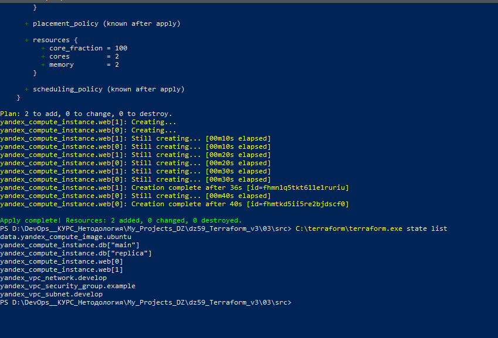
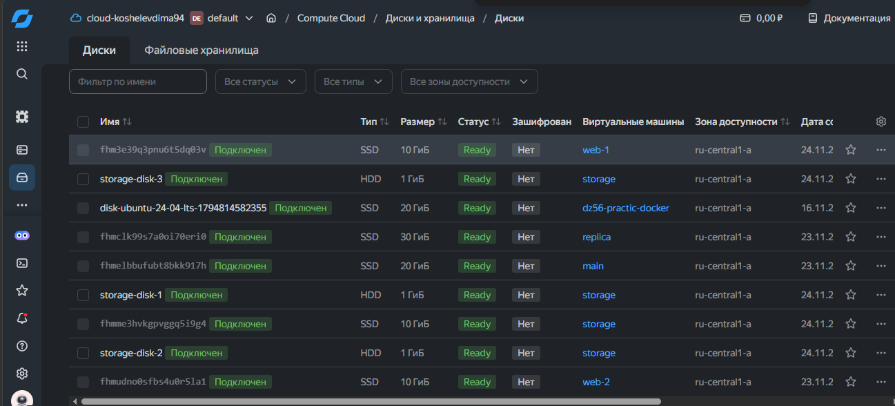

# Домашнее задание к занятию "Управляющие конструкции в коде Terraform" - Кошелев Дмитрий Владимирович


##Задание 1


## Решение
```

```

;
;
;
;
;
;
;
;


##Задание 2


## Решение


;

##Задание 3


## Решение


;
;


##Задание 4


## Решение


;
