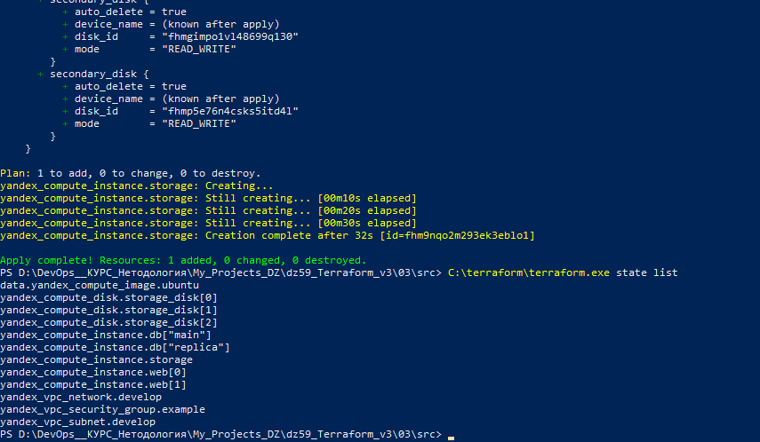
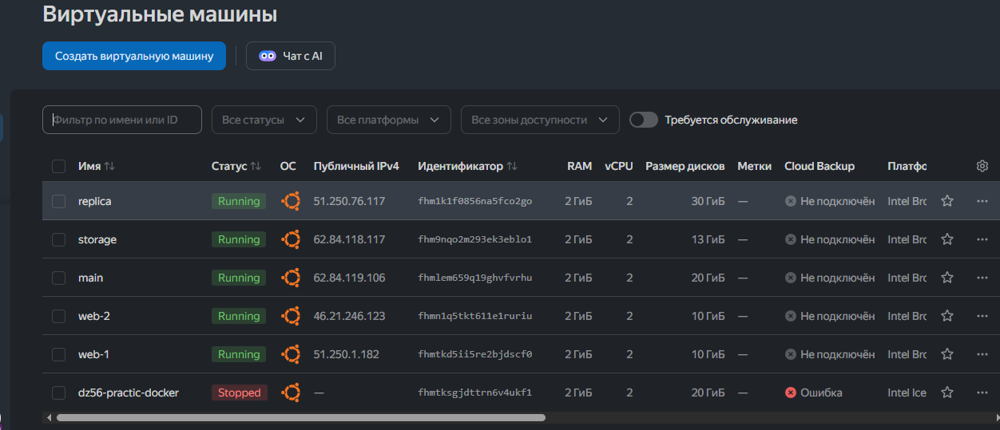
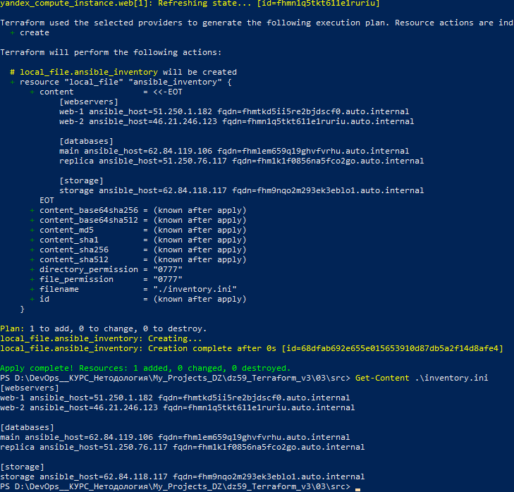
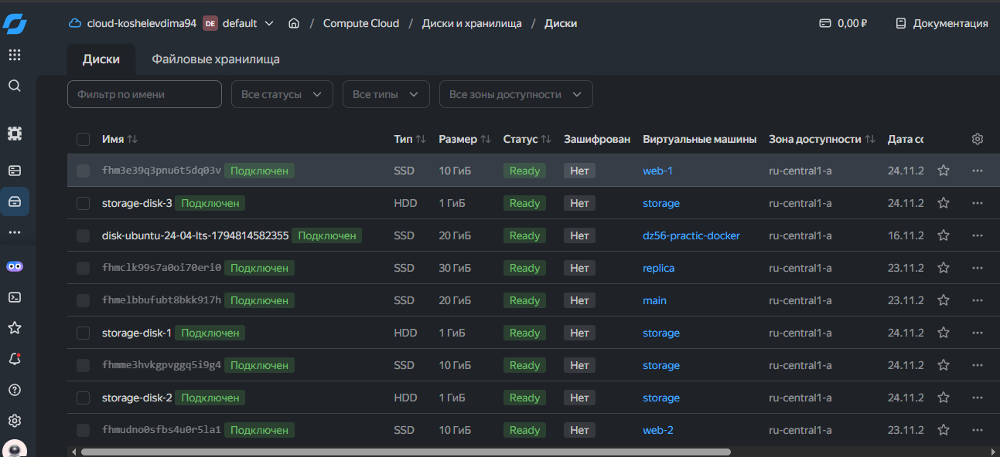
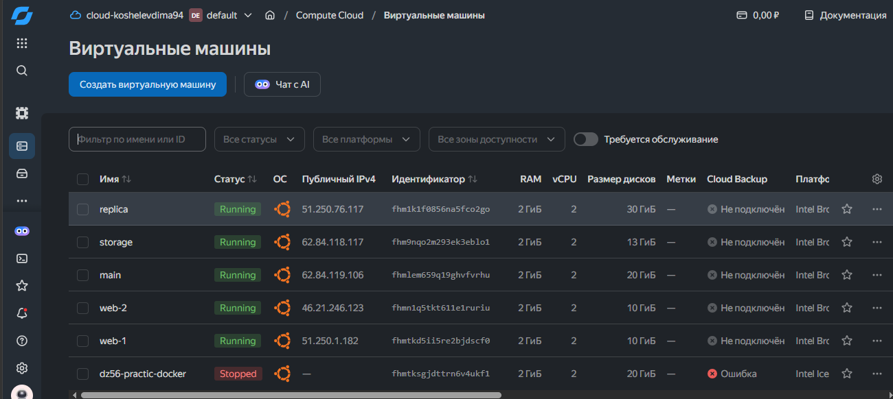
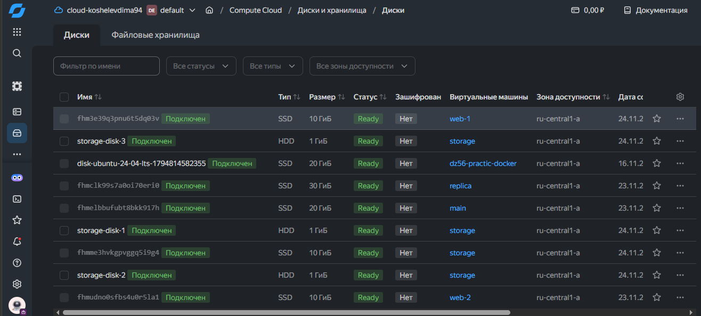

# Домашнее задание к занятию "Управляющие конструкции в коде Terraform" - Кошелев Дмитрий Владимирович

##Задание 1
Изучите проект.
Инициализируйте проект, выполните код.
Приложите скриншот входящих правил «Группы безопасности» в ЛК Yandex Cloud .

## Решение

Созданы ресурсы:
VPC-сеть `develop` (`yandex_vpc_network.develop`)
Подсеть `develop` в зоне `ru-central1-a`, CIDR `10.0.1.0/24` (`yandex_vpc_subnet.develop`)
Группа безопасности `example_dynamic` (`yandex_vpc_security_group.example`) с динамическими блоками `ingress`/`egress`.
Входящие правила: SSH (22/TCP), HTTP (80/TCP), HTTPS (443/TCP), все `0.0.0.0/0`.
Исходящее правило: весь исходящий трафик `0.0.0.0/0`, порты 1–65365.
Секреты и state-файлы исключены через `.gitignore`.

#
Как назначить группу безопасности ВМ?
В ресурсе yandex_compute_instance в блоке network_interface используется параметр security_group_ids = [yandex_vpc_security_group.example.id]. 
Ссылка идёт ресурса (example), а не на отображаемое имя (example_dynamic).

;
;

##Задание 2
Создайте файл count-vm.tf. Опишите в нём создание двух одинаковых ВМ web-1 и web-2 (не web-0 и web-1) с минимальными параметрами, используя мета-аргумент count loop. Назначьте ВМ созданную в первом задании группу безопасности.(как это сделать узнайте в документации провайдера yandex/compute_instance )
Создайте файл for_each-vm.tf. Опишите в нём создание двух ВМ для баз данных с именами "main" и "replica" разных по cpu/ram/disk_volume , используя мета-аргумент for_each loop. Используйте для обеих ВМ одну общую переменную типа:
variable "each_vm" {
  type = list(object({  vm_name=string, cpu=number, ram=number, disk_volume=number }))
}
При желании внесите в переменную все возможные параметры. 3. ВМ, описанные в файле count-vm.tf, должны создаваться после ВМ, описанных в файле for_each-vm.tf. 4. Используйте функцию file в local-переменной для считывания ключа ~/.ssh/id_rsa.pub и его последующего использования в блоке metadata, взятому из ДЗ 2. 5. Инициализируйте проект, выполните код.

## Решение

count-vm.tf: две одинаковые ВМ web-1 и web-2 через count = 2, имена формируются как web-${count.index + 1}. Привязана группа безопасности example_dynamic.
for_each-vm.tf: две БД-ВМ main и replica с разными cpu/ram/disk через for_each = { for vm in var.each_vm : vm.vm_name => vm }.
variables.tf: переменная each_vm типа list(object({ vm_name=string, cpu=number, ram=number, disk_volume=number })). Значения: main cpu=2 ram=2 disk=20; replica cpu=2 ram=2 disk=30.
depends_on = [yandex_compute_instance.db] — web-ВМ создаются после БД-ВМ.
locals.tf: ssh_public_key = file("~/.ssh/id_rsa.pub"), ключ используется в metadata обеих ВМ.

;

##Задание 3

Создайте 3 одинаковых виртуальных диска размером 1 Гб с помощью ресурса yandex_compute_disk и мета-аргумента count в файле disk_vm.tf .
Создайте в том же файле одиночную(использовать count или for_each запрещено из-за задания №4) ВМ c именем "storage" . Используйте блок dynamic secondary_disk{..} и мета-аргумент for_each для подключения созданных вами дополнительных дисков.

## Решение

Создан disk_vm.tf.
Созданы 3 одинаковых виртуальных диска по 1 ГБ через yandex_compute_disk с мета-аргументом count = 3:
storage-disk-1 (id fhmgimpo1vl48699q130)
storage-disk-2 (id fhmp5e76n4csks5itd4l)
storage-disk-3 (id fhm8ig7v9hia83dkm20g)
Создана одиночная ВМ storage (без count/for_each, согласно заданию №4):
2 vCPU, 2 ГБ RAM
загрузочный диск 10 ГБ SSD
публичный IP, SSH-ключ из local.ssh_public_key
Дополнительные диски подключены к ВМ через dynamic "secondary_disk" + for_each = yandex_compute_disk.storage_disk:
в конфигурации ВМ видны три блока secondary_disk с ID дисков
auto_delete = true
Выполнены terraform init, validate, plan, apply.
Результат: Apply complete! Resources: 1 added, 0 changed, 0 destroyed. Все три диска подключены к ВМ storage.

Почему count даёт web-1 и web-2, а не web-0 и web-1? count.index начинается с 0, поэтому используется count.index + 1.
Почему for_each не работает напрямую с list? for_each принимает map или set(string). Список преобразуется в map через { for vm in var.each_vm : vm.vm_name => vm }, где ключ — имя ВМ.
Зачем depends_on? Чтобы гарантировать порядок создания: сначала БД, потом web.
Почему cpu = 1 не работает? Платформа standard-v1 (Intel Broadwell) поддерживает минимум 2 vCPU. Допустимые значения: 2, 4, 6, 8 и далее. Память при 2 vCPU — минимум 2 ГБ.
Почему type = network-ssd? Из-за квоты на HDD-диски в зоне ru-central1-a. SSD-квота оказалась свободнее.

#
Создан disk_vm.tf.
3 одинаковых диска по 1 ГБ через yandex_compute_disk с count = 3: storage-disk-1, storage-disk-2, storage-disk-3.
Одиночная ВМ storage без count и for_each: 2 vCPU, 2 ГБ RAM, загрузочный диск 10 ГБ SSD, публичный IP, SSH-ключ.
Диски подключены через dynamic "secondary_disk" + for_each = yandex_compute_disk.storage_disk. В конфигурации ВМ три блока secondary_disk с ID дисков, auto_delete = true.

Почему for_each в dynamic работает с ресурсом, созданным через count? Terraform позволяет итерироваться по ресурсу с count в dynamic-блоке: for_each = yandex_compute_disk.storage_disk даёт коллекцию из трёх дисков, secondary_disk.value — текущий диск.

Зачем auto_delete = true? Чтобы при удалении ВМ дополнительные диски удалялись автоматически.

;
;
;

##Задание 4
В файле ansible.tf создайте inventory-файл для ansible. Используйте функцию tepmplatefile и файл-шаблон для создания ansible inventory-файла из лекции. Готовый код возьмите из демонстрации к лекции demonstration2. Передайте в него в качестве переменных группы виртуальных машин из задания 2.1, 2.2 и 3.2, т. е. 5 ВМ.
Инвентарь должен содержать 3 группы и быть динамическим, т. е. обработать как группу из 2-х ВМ, так и 999 ВМ.
Добавьте в инвентарь переменную fqdn.
[webservers]
web-1 ansible_host=<внешний ip-адрес> fqdn=<полное доменное имя виртуальной машины>
web-2 ansible_host=<внешний ip-адрес> fqdn=<полное доменное имя виртуальной машины>

[databases]
main ansible_host=<внешний ip-адрес> fqdn=<полное доменное имя виртуальной машины>
replica ansible_host<внешний ip-адрес> fqdn=<полное доменное имя виртуальной машины>

[storage]
storage ansible_host=<внешний ip-адрес> fqdn=<полное доменное имя виртуальной машины>
Пример fqdn: web1.ru-central1.internal(в случае указания переменной hostname(не путать с переменной name)); fhm8k1oojmm5lie8i22a.auto.internal(в случае отсутвия перменной hostname - автоматическая генерация имени, зона изменяется на auto). нужную вам переменную найдите в документации провайдера или terraform console. 4. Выполните код. Приложите скриншот получившегося файла.

Для общего зачёта создайте в вашем GitHub-репозитории новую ветку terraform-03. Закоммитьте в эту ветку свой финальный код проекта, пришлите ссылку на коммит.
Удалите все созданные ресурсы.

## Решение

Создан inventory.tftpl — шаблон Ansible inventory с тремя группами [webservers], [databases], [storage] и динамическими for-циклами.

Создан ansible.tf: locals собирают данные из ресурсов yandex_compute_instance.web, .db, .storage (имя, внешний IP, FQDN), local_file.ansible_inventory рендерит inventory.ini через templatefile.

Inventory динамический: при изменении count или for_each файл автоматически пересобирается. Обрабатывает и 2 ВМ, и 999.

Для каждой ВМ добавлена переменная fqdn.

#
Откуда берётся fqdn? Из атрибута fqdn ресурса yandex_compute_instance. Если hostname не задан — генерируется автоматически как <id>.auto.internal. Если hostname задан — <hostname>.<region_id>.internal.

Почему inventory динамический? В шаблоне используются %{ for vm in webservers ~} ... %{ endfor ~}. При изменении количества ВМ шаблон автоматически отрендерит нужное число строк.

Почему local_file, а не template_file? template_file — data source (устарел), local_file — ресурс, который создаёт файл на диске. Для генерации inventory это стандартный подход.

;
;
;
;